# Tactile Posterior-Guided Hex-Socket Engagement

**An illustrated research and learning record: tactile inference, uncertainty-aware planning, and physical validation.**

A robot can see where a screw is approximately, yet still miss its hexagonal socket by a few millimetres. This project investigates whether a gentle contact probe can tell the robot which way to search, while preserving uncertainty about how far to move. The resulting system combines tactile inference, a bounded initial movement, local search, compliant control, and independent engagement verification.

This repository supplements a research progress report. It preserves code, data, CAD, experiment records, and demonstration videos. The demonstrated task is **geometric socket engagement**; rotation, thread release, and screw extraction are subsequent stages for future work. The manuscript is a working draft. No project-wide open-source license has been assigned.

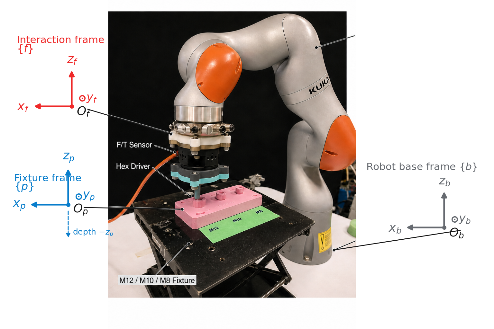

*The physical setup makes the central difficulty concrete: a small alignment error at the tool tip can change the contact state, even when the robot is already close to the target.*

**AI-assisted workflow.** ChatGPT, Claude, and Codex supported research discussion, formalization review, implementation, debugging, and documentation at different stages. This README and its companion workbook were prepared with Codex assistance using project code, design records, and experimental evidence. The author remains responsible for reviewing assisted outputs and the resulting research claims. The narrative distinguishes completed work from proposed experiments and learning activities; the [workbook](docs/AI_ASSISTED_RESEARCH.md#what-the-records-establish) records the available provenance.

## Experiments in motion

All **16 distinct videos** embedded in the reviewed project presentations are available below: **6 simulation recordings and 10 hardware recordings**. Each has an inline animation and a full MP4 download. Repeated copies across presentations are included once; the [coverage map](docs/MEDIA_GALLERY.md#presentation-coverage) links every embedded source to its recording.

GIF banners show speed relative to the source video. The full MP4s preserve the source timeline and source playback rate, with audio removed. Some original clips are already accelerated; video duration is not a controller-measured task time. The [paired simulation benchmark](#4-use-simulation-to-test-mechanisms) and [hardware records](#6-connect-models-software-and-hardware) provide the quantitative context. These recordings concern socket engagement.

[Simulation recordings](#simulation-recordings) · [Hardware recordings](#hardware-recordings) · [All MP4 downloads](https://github.com/nanjinyao/tactile-posterior-guided-engagement/releases/tag/media-gallery-2026-10-28) · [Research reading guide](#reading-guide)

### Simulation recordings

#### 1. Four-channel and three-channel direct cues

[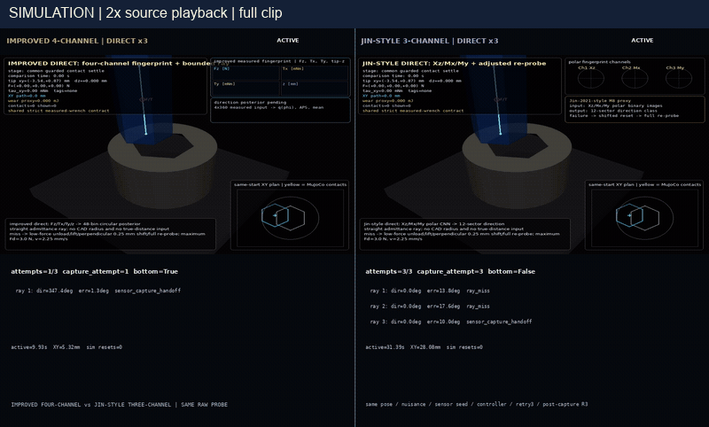](https://github.com/nanjinyao/tactile-posterior-guided-engagement/releases/download/media-gallery-2026-10-28/simulation-channel-comparison.mp4)

M8 Sobol 005: a side-by-side representation comparison with physical retries. The three-channel comparator is a paper-inspired proxy. **Preview: 2x source playback.** [Full MP4 (34.20 s)](https://github.com/nanjinyao/tactile-posterior-guided-engagement/releases/download/media-gallery-2026-10-28/simulation-channel-comparison.mp4).

#### 2. Muted tactile cue

[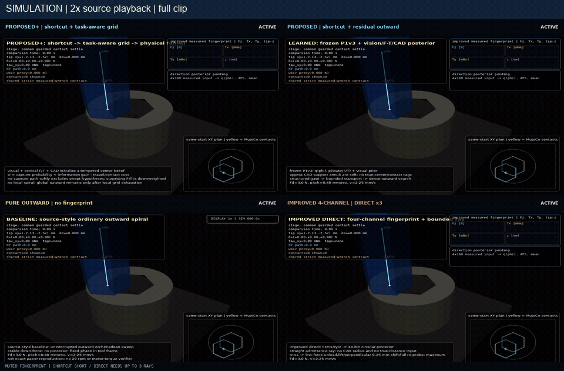](https://github.com/nanjinyao/tactile-posterior-guided-engagement/releases/download/media-gallery-2026-10-28/simulation-muted-cue.mp4)

M8 Sobol 016: uncertain tactile evidence leads to a shorter shortcut; the direct-cue arm misses all three rays in this selected case. **Preview: 2x source playback.** [Full MP4 (43.73 s)](https://github.com/nanjinyao/tactile-posterior-guided-engagement/releases/download/media-gallery-2026-10-28/simulation-muted-cue.mp4).

#### 3. Clear tactile cue

[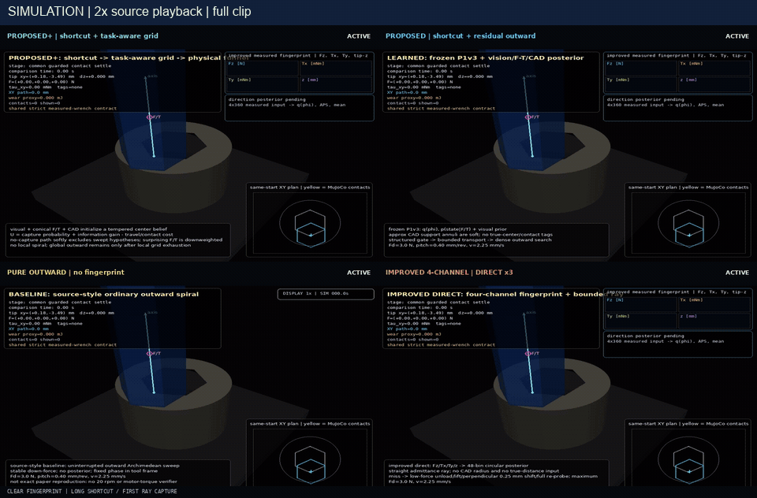](https://github.com/nanjinyao/tactile-posterior-guided-engagement/releases/download/media-gallery-2026-10-28/simulation-clear-cue.mp4)

M8 Sobol 000: concentrated directional evidence supports a longer shortcut. Four methods begin from the same selected start. **Preview: 2x source playback.** [Full MP4 (35.40 s)](https://github.com/nanjinyao/tactile-posterior-guided-engagement/releases/download/media-gallery-2026-10-28/simulation-clear-cue.mp4).

#### 4. Grid search: information and capture value

[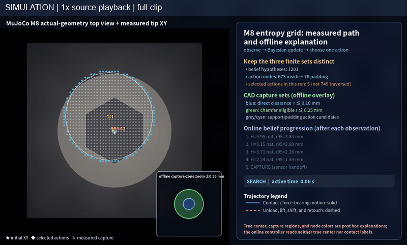](https://github.com/nanjinyao/tactile-posterior-guided-engagement/releases/download/media-gallery-2026-10-28/simulation-grid-information.mp4)

Top-view replay of the measured tip path, belief updates, and selected actions. The CAD capture sets are offline explanatory overlays. **Preview: 1x source playback.** [Full MP4 (10.00 s)](https://github.com/nanjinyao/tactile-posterior-guided-engagement/releases/download/media-gallery-2026-10-28/simulation-grid-information.mp4).

#### 5. Post-capture tilt and protective response

[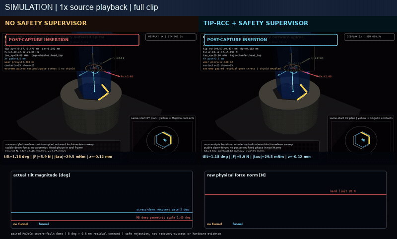](https://github.com/nanjinyao/tactile-posterior-guided-engagement/releases/download/media-gallery-2026-10-28/simulation-recovery-a.mp4)

Side-by-side simulation of insertion without the safety supervisor and with tip-RCC plus supervision. The clip includes the protected termination behavior. **Preview: 1x source playback.** [Full MP4 (19.27 s)](https://github.com/nanjinyao/tactile-posterior-guided-engagement/releases/download/media-gallery-2026-10-28/simulation-recovery-a.mp4).

#### 6. Post-capture funnel guard

[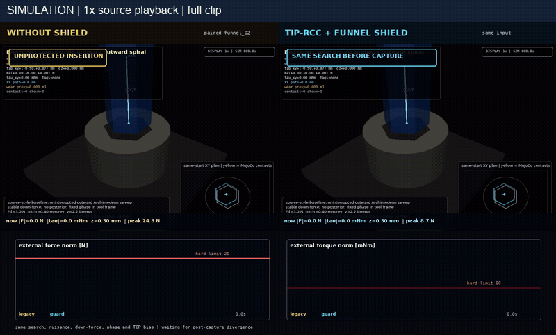](https://github.com/nanjinyao/tactile-posterior-guided-engagement/releases/download/media-gallery-2026-10-28/simulation-recovery-b.mp4)

Side-by-side simulation of unprotected insertion and the funnel guard, including force monitoring and contact unloading. **Preview: 1x source playback.** [Full MP4 (8.87 s)](https://github.com/nanjinyao/tactile-posterior-guided-engagement/releases/download/media-gallery-2026-10-28/simulation-recovery-b.mp4).

### Hardware recordings

#### 7. Conical tactile acquisition

[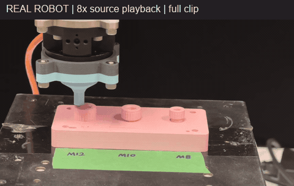](https://github.com/nanjinyao/tactile-posterior-guided-engagement/releases/download/media-gallery-2026-10-28/hardware-conical-probe.mp4)

The printed tool and fixture during tactile probing. The 78 completed scans reported elsewhere describe acquisition records, rather than 78 engagement successes in this clip. **Preview: 8x source playback.** [Full MP4 (172.90 s)](https://github.com/nanjinyao/tactile-posterior-guided-engagement/releases/download/media-gallery-2026-10-28/hardware-conical-probe.mp4).

#### 8. Conical probing: short demonstration

[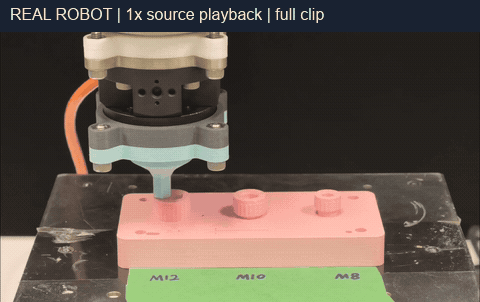](https://github.com/nanjinyao/tactile-posterior-guided-engagement/releases/download/media-gallery-2026-10-28/hardware-probe-short.mp4)

The additional short probing clip embedded in the earlier group-meeting presentation. **Preview: 1x source playback.** [Full MP4 (15.50 s)](https://github.com/nanjinyao/tactile-posterior-guided-engagement/releases/download/media-gallery-2026-10-28/hardware-probe-short.mp4).

#### 9. M12 grid search

[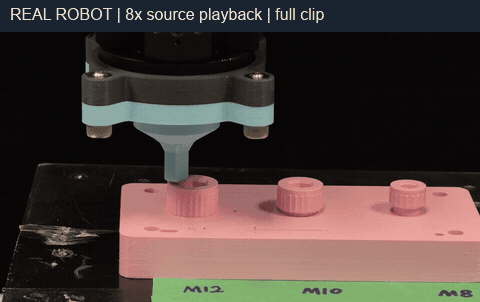](https://github.com/nanjinyao/tactile-posterior-guided-engagement/releases/download/media-gallery-2026-10-28/hardware-m12-grid.mp4)

The source presentation labels this recording “M12 Entropy Grid (Successful)”. **Preview: 8x source playback.** [Full MP4 (136.00 s)](https://github.com/nanjinyao/tactile-posterior-guided-engagement/releases/download/media-gallery-2026-10-28/hardware-m12-grid.mp4).

#### 10. M12 shortcut and spiral search

[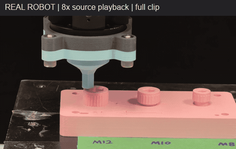](https://github.com/nanjinyao/tactile-posterior-guided-engagement/releases/download/media-gallery-2026-10-28/hardware-m12-shortcut-spiral.mp4)

The source presentation labels this recording “M12 Shortcut Spiral (Successful)”. **Preview: 8x source playback.** [Full MP4 (198.52 s)](https://github.com/nanjinyao/tactile-posterior-guided-engagement/releases/download/media-gallery-2026-10-28/hardware-m12-shortcut-spiral.mp4).

#### 11. M12 direct shortcut

[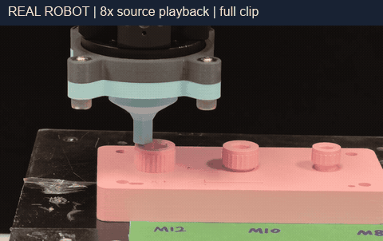](https://github.com/nanjinyao/tactile-posterior-guided-engagement/releases/download/media-gallery-2026-10-28/hardware-m12-direct.mp4)

The source presentation labels this recording “M12 Direct Shortcut (Successful)”. **Preview: 8x source playback.** [Full MP4 (113.92 s)](https://github.com/nanjinyao/tactile-posterior-guided-engagement/releases/download/media-gallery-2026-10-28/hardware-m12-direct.mp4).

#### 12. M12 pure helix: timeout

[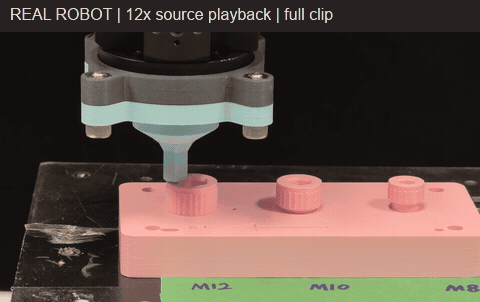](https://github.com/nanjinyao/tactile-posterior-guided-engagement/releases/download/media-gallery-2026-10-28/hardware-m12-helix-timeout.mp4)

The source presentation labels this recording “M12 Pure Helix (Failed Timeout)”. It preserves an unsuccessful attempt for comparison and diagnosis. **Preview: 12x source playback.** [Full MP4 (411.58 s)](https://github.com/nanjinyao/tactile-posterior-guided-engagement/releases/download/media-gallery-2026-10-28/hardware-m12-helix-timeout.mp4).

#### 13. M12 pure helix: no time limit

[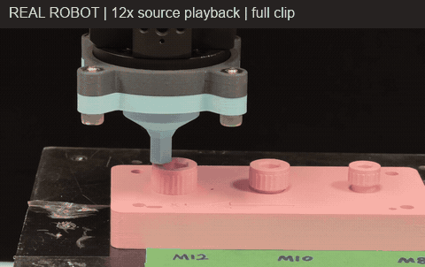](https://github.com/nanjinyao/tactile-posterior-guided-engagement/releases/download/media-gallery-2026-10-28/hardware-m12-helix-no-time-limit.mp4)

The source presentation labels this recording as successful without a time limit and marks it as accelerated. Its source playback is retained; it is not a matched-budget timing comparison with the timeout trial. **Preview: 12x source playback.** [Full MP4 (380.43 s)](https://github.com/nanjinyao/tactile-posterior-guided-engagement/releases/download/media-gallery-2026-10-28/hardware-m12-helix-no-time-limit.mp4).

#### 14. M12 grid: residual replanning

[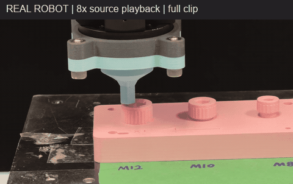](https://github.com/nanjinyao/tactile-posterior-guided-engagement/releases/download/media-gallery-2026-10-28/hardware-m12-grid-replanning.mp4)

The source presentation describes a shortcut miss followed by residual replanning (PGS-G). **Preview: 8x source playback.** [Full MP4 (210.96 s)](https://github.com/nanjinyao/tactile-posterior-guided-engagement/releases/download/media-gallery-2026-10-28/hardware-m12-grid-replanning.mp4).

#### 15. M12 direct cue: re-probing

[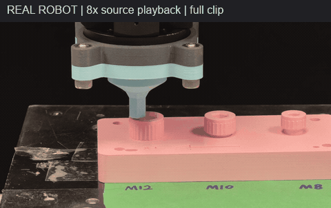](https://github.com/nanjinyao/tactile-posterior-guided-engagement/releases/download/media-gallery-2026-10-28/hardware-m12-direct-reprobe.mp4)

The source presentation describes a first-ray miss followed by re-probing and capture (Direct-4C). **Preview: 8x source playback.** [Full MP4 (193.70 s)](https://github.com/nanjinyao/tactile-posterior-guided-engagement/releases/download/media-gallery-2026-10-28/hardware-m12-direct-reprobe.mp4).

#### 16. M10 grid search

[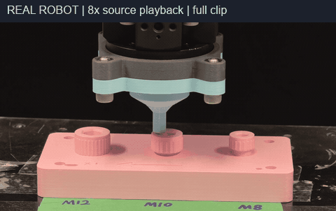](https://github.com/nanjinyao/tactile-posterior-guided-engagement/releases/download/media-gallery-2026-10-28/hardware-m10-grid.mp4)

The source presentation labels this recording “M10 Entropy Grid (Successful)”; the tool operates at the middle socket of the fixture. **Preview: 8x source playback.** [Full MP4 (155.12 s)](https://github.com/nanjinyao/tactile-posterior-guided-engagement/releases/download/media-gallery-2026-10-28/hardware-m10-grid.mp4).

The hardware method and outcome descriptions follow the source slide captions. Video frames alone do not measure force, insertion depth, or dwell criteria. See the [media provenance notes](docs/MEDIA_GALLERY.md#presentation-coverage) and experimental records for interpretation.

## Reading guide

- [Experiments in motion](#experiments-in-motion)
- [Full video gallery](docs/MEDIA_GALLERY.md)
- [The research idea in plain language](#the-research-idea-in-plain-language)
- [1. Find a question worth answering](#1-find-a-question-worth-answering)
- [2. Turn reading into a literature review](#2-turn-reading-into-a-literature-review)
- [3. Formalize the problem and the solution](#3-formalize-the-problem-and-the-solution)
- [4. Use simulation to test mechanisms](#4-use-simulation-to-test-mechanisms)
- [5. Turn CAD into a physical experiment](#5-turn-cad-into-a-physical-experiment)
- [6. Connect models, software, and hardware](#6-connect-models-software-and-hardware)
- [7. Lessons from iteration](#7-lessons-from-iteration)
- [8. Make the contribution and learning explicit](#8-make-the-contribution-and-learning-explicit)
- [If I repeated this project](#if-i-repeated-this-project)
- [Repository, data, and reproduction](#repository-data-and-reproduction)

For a reusable context template, suggested prompts, interface contracts, derivation exercises, and contribution logs, see the [AI-assisted research workbook](docs/AI_ASSISTED_RESEARCH.md). Its prompts are newly proposed examples, not reconstructed quotations from past conversations.

## The research idea in plain language

Imagine trying to place a key into a partly hidden keyhole. A small, controlled touch may reveal that the opening lies to the left. It does not necessarily reveal the exact distance. Moving straight to a guessed point can therefore fail, even when the directional prediction is useful.

The same distinction motivates this project:

1. **Touch deliberately.** A low-force conical probe produces a structured force/torque fingerprint.
2. **Estimate a distribution.** Infer likely directions and retain multiple possible hole centres.
3. **Move conservatively.** Use that uncertainty to limit an initial shortcut.
4. **Search what remains.** Continue with a local outward search or a task-aware grid policy.
5. **Verify physically.** A separate controller checks capture, insertion, and dwell conditions.

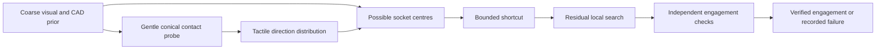

The useful design principle is to give learning a compact job: turn contact into information that a controller can use. Confidence from a model does not replace a physical success check.

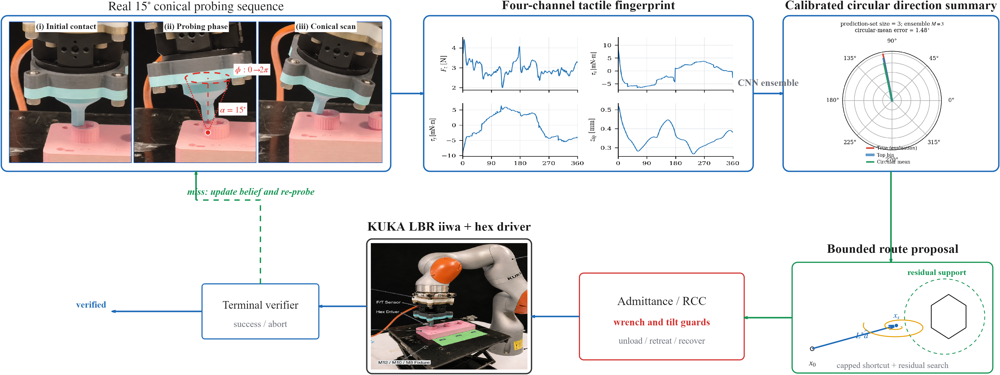

*This figure combines real apparatus/action photographs with a held-out simulation fingerprint and inference illustration. The simulation uses a four-channel CNN; the later real-device runtime uses a different seven-channel Fourier-based interface. The panels should not be read as evidence that the simulation CNN was deployed unchanged on the robot.*

## 1. Find a question worth answering

The initial application, robotic unscrewing, was too broad to diagnose in one experiment. It includes perception, alignment, contact, torque transmission, thread release, and extraction. A useful research question emerged by isolating the engagement bottleneck:

> When contact provides useful direction but uncertain distance, can a bounded, posterior-guided search reduce unnecessary motion while preserving independently verified engagement?

**How AI helped.** The [design decisions](mujoco_unscrewing_probe_new/DESIGN_DECISIONS.md), including the entry dated `2026-07-09 23:23`, record a ChatGPT roadmap covering multiple sizes, geometry, contact reasoning, conical exploration, and information gain. The immediate implementation was narrowed to an M8-first chain: sampling, labels, model, evidence, and action. AI was useful for enumerating possibilities and exposing missing links between them.

**Where the researcher has to think.** A list of plausible ideas does not determine which one deserves an experiment. The researcher must identify the physical bottleneck, decide what the robot can actually observe, choose an endpoint, and explain what result would contradict the idea. Here, the critical distinction is direction versus distance: treating a direction estimate as a precise centre would hide the unresolved part of the problem.

**What I would improve.** Before requesting a broad roadmap, write a one-page problem note with a photograph, a failure trace, the available signals, and two competing explanations. Ask AI to challenge that note. Commit to one falsifiable question and one small experiment before adding sizes, planners, or neural architectures.

## 2. Turn reading into a literature review

A useful review is an argument about assumptions and evidence. For this project, the reading should connect four layers: the assembly/disassembly task, contact-based sensing, decision-making under uncertainty, and compliant control.

The following are reading anchors already present in the [project bibliography](overleaf_unscrewing/references.bib), rather than a claim of an exhaustive or current state-of-the-art survey.

| Reading role | Bibliography anchors | Question to answer while reading |
|---|---|---|
| Application and task boundaries | `diaz2025unscrewing` | Which stage fails: locating, engaging, turning, or extracting? |
| Contact-based pose information | `jin2021contact`, `kim2022active` | What is sensed, what motion creates information, and which ambiguities remain? |
| Partial observability and action selection | `wirnshofer2020partial` | What belief is maintained, and how does it affect the next action? |
| Force-guided exploration and learned representations | `noseworthy2025forge`, `lee2019visiontouch` | What data and interventions support the learned policy or representation? |
| Physical interaction control | `hogan1985impedance` | How are force, motion, compliance, and stability related? |

**A concrete AI-assisted review workflow.** Start with a narrow question, search terms, and inclusion criteria. Read the primary paper and annotate its equations, sensing assumptions, evaluation conditions, and limitations. Give AI those source passages and ask it to populate a comparison matrix with page/section evidence. Check every important cell against the paper. Finally, write the synthesis yourself: which assumption differs from this apparatus, and what experiment would expose the difference?

The most useful output is a table such as **sensors → observation → hidden variables → permitted actions → success definition → comparison conditions**. This makes it harder to compare a method with ground-truth information against one using noisy contact alone.

**What I would improve.** Keep a literature ledger containing the exact source, a short independently written explanation, one derivation or toy example, and a design consequence. Ask AI for counterarguments and missing references after forming my own view. A fluent summary should never substitute for being able to explain a central equation or reproduce a small result.

## 3. Formalize the problem and the solution

### What is known, observed, and hidden?

| Quantity | Plain-language meaning | Role in this project |
|---|---|---|
| Tool position and coordinate conventions | Where the controller believes it is moving | Motion reference; commanded and measured quantities must be distinguished |
| Coarse prior over socket centre | Where the opening might be before touching | Initial uncertainty from the task setup |
| Probe fingerprint | How force, torque, and tip height change during a controlled probe | Input to tactile inference |
| Direction distribution | Which angular sectors are compatible with the contact | Learned information, with uncertainty |
| Socket centre and contact state | Where the opening really is and how contact is occurring | Partly hidden; simulation truth is for labels/evaluation only |
| Shortcut and residual search | The next physical motions | Chosen under action and control limits |
| Engagement verification | Whether the tool has actually entered and remained engaged | Independent terminal evidence |

The simulation observation contains 360 phase samples of four channels: axial force, two bending moments, and tip height. A roughly 15-degree conical probe supplies the excitation. Three CNN seeds produce distributions over 48 direction bins, with temperature calibration and disagreement/quality information. Probe phase and target direction are different quantities and require explicit frame conventions.

### From a direction estimate to possible centres

Rather than select one exact centre, the planner represents alternatives with particles. In the documented M8 setting, 4,096 particles start from a Gaussian prior with a 2 mm scale, truncated at a radius of approximately 4.895 mm. The angular estimate and a soft, CAD-related contact-support factor update their relative weights.

In simplified form:

$$
b(c\mid o) \propto b_0(c)\,L_{\mathrm{direction}}(o,c)\,L_{\mathrm{support}}(o,c).
$$

Here, $b_0$ is the prior, $o$ is the probe observation, and $c$ is a candidate centre. The support factor has a floor, so uncertain contact evidence does not automatically eliminate every alternative. This is an engineering inference model with assumptions to test; it is not a complete, experimentally identified model of all contact dynamics.

**How AI can help with formalization.** It can check dimensions, separate coordinate frames, expand a Bayes update, and produce counterexamples to an overstrong claim. The recorded early Claude-assisted review included notation/frame separation, a general joint Bayesian transition, and the need for a predictive observation distribution when claiming information gain. Those reviews do not establish that every discussed formulation became part of the final implementation; the [workbook](docs/AI_ASSISTED_RESEARCH.md#what-the-records-establish) explains the provenance limits.

### Convert uncertainty into a bounded action

The shortcut uses the lower tail of forward progress, a distance cap, and a controller limit. In plain language: move less when the posterior is ambiguous, and do not command a forward shortcut when substantial probability lies behind the tool.

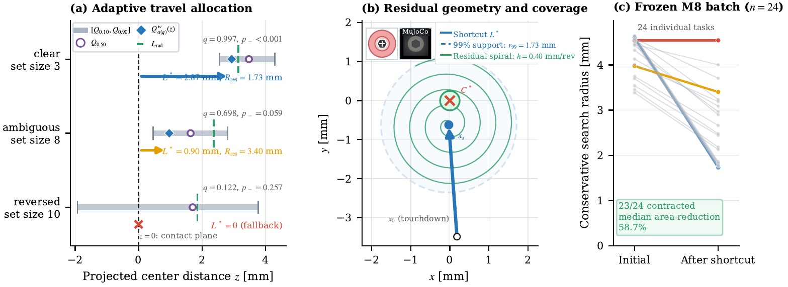

*A direction estimate narrows the search, but the remaining spread still matters. The residual region is retained for subsequent search rather than treated as an already solved localization problem.*

<details>
<summary>Mathematical detail: the documented shortcut rule and its limits</summary>

Let $x_0$ be the starting position, $d$ the selected unit direction, and $z=d^\top(c-x_0)$ the forward projection of a candidate centre. The documented form is

$$
L^*=\min\left(\left[Q_\alpha(z)-0.25r_{\mathrm{eff}}\right]_+,\;\lambda(q)Q_\rho(\|c-x_0\|),\;L_c\right),
$$

where $q$ is a direction-quality score, $r_{\mathrm{eff}}$ an effective capture radius, and $L_c$ a controller limit. The scheduled parameters are $\alpha=0.10+0.15q$ and $\lambda(q)=0.35+0.30q$. Reverse probability mass of at least 0.20 suppresses the shortcut. The manuscript setting uses $\rho=0.99$; the generic function default is 0.95, so reproduction must use the experiment configuration rather than assume the default.

This is a bounded action heuristic supported by the recorded experiments. Posterior support is not a guarantee of physical capture. Similarly, a finite spiral pitch alone does not prove complete coverage of a finite search boundary. Calibration, model mismatch, contact mechanics, and boundary geometry still matter.

Implementation: [posterior_search_plan.py](mujoco_unscrewing_probe_new/src/posterior_search_plan.py).

</details>

### Keep inference and verification separate

The outward variant, **PGS-O**, follows the shortcut with local outward search. **PGS-G** uses a task-aware grid policy combining information, capture, and motion cost. Both operate with compliant control, force/tilt limits, and distinct capture, insertion, and dwell checks. Recovery can be enabled, with up to three recoveries in the documented comparison.

**What I would improve.** Derive a minimal two-dimensional version on paper, implement it without a neural model, and test a clear posterior, a bimodal posterior, a reversed posterior, and a deliberately wrong prior. Only then add learned likelihoods. I should be able to explain which assumption makes each action reasonable and construct a case in which it fails.

## 4. Use simulation to test mechanisms

Simulation is useful because hidden geometry and repeatable starts are available for evaluation. It becomes misleading if those hidden variables accidentally enter the online policy or if methods receive different information, budgets, or success definitions.

**How AI can help.** It can scaffold data generation, inspect tensor shapes, write analysis scripts, trace configuration differences, and propose ablations. The researcher must still define the split, keep ground truth out of policy inputs, freeze comparison conditions, and inspect trajectories rather than trust a summary table.

The recorded benchmark contains 24 paired M8 cases with a 130 s budget:

| Method | Verified successes | Median time (s) | Median path (mm) | Median contact-work proxy |
|---|---:|---:|---:|---:|
| PGS-O: shortcut + outward search | 20/24 | 13.87 | 14.52 | 28.48 |
| PGS-G: shortcut + task-aware grid | 19/24 | 13.74 | 6.76 | 9.54 |
| Outward search without the probe | 19/24 | 34.63 | 71.27 | 120.38 |
| Direct four-channel cue, retry-3 | 17/24 | 9.22 | 6.07 | 13.67 |
| Jin-style three-channel proxy, retry-3 | 16/24 | 8.96 | 5.67 | 13.22 |

**Read the table carefully:** time, path, and contact-work proxy medians are computed on each method's own successful cases. They do not establish unconditional superiority. The Jin-style comparator is an engineering proxy, not a claim of reproducing every detail of the original paper.

Across the 19 cases where both PGS-O and Outward succeeded, every PGS-O path was shorter; the median paired difference was approximately -41.14 mm. The evidence does **not** show a clear additional paired advantage for PGS-G over PGS-O. In a separate fixed 12-case recovery comparison, R0 succeeded in 0 cases and R3 in 9; that selected comparison is not a population success-rate estimate.

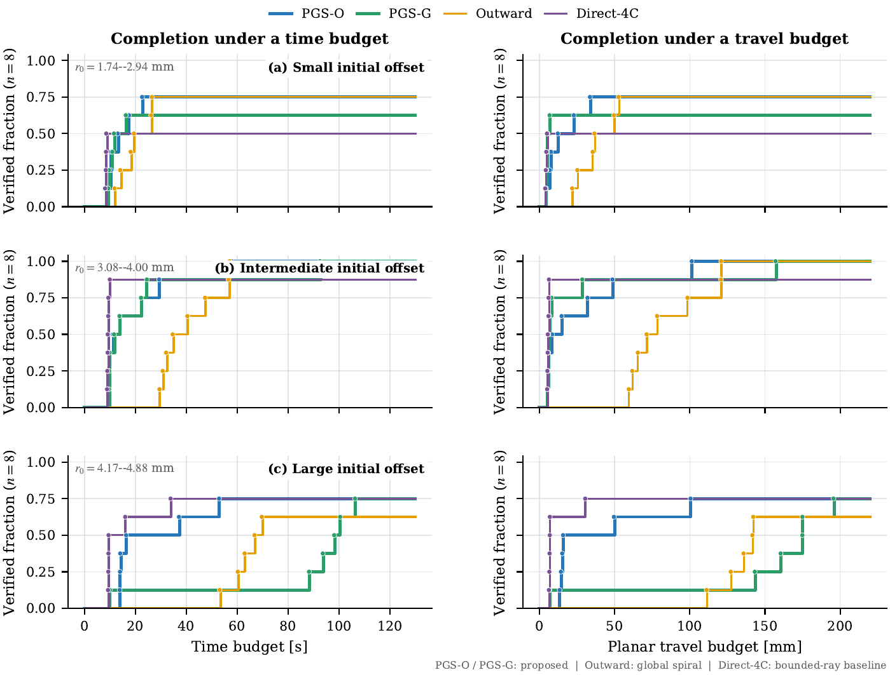

*These profiles show how completion depends on available time and travel, rather than reducing the experiment to one success-conditioned median. The underlying evidence and figure inputs are indexed in [REPRODUCIBILITY.md](REPRODUCIBILITY.md).*

Cross-size fine-tuning also did not provide a stable held-out improvement over zero-shot/calibration-only alternatives, and the M10 hard-stop gate failed. These negative results limit the scope of the learned model and belong in the research story.

**What I would improve.** Use a small mechanism ladder: classical direction cue → learned direction → bounded shortcut → residual search → recovery. Add one component at a time, retain identical starts and budgets, and declare the primary outcome before examining the results. Keep a development set for debugging and an untouched test set for the final comparison. Ask AI to look for leakage and unfair advantages before asking it to improve performance.

## 5. Turn CAD into a physical experiment

The hardware stage required more than transferring code. Printed geometry, assembly alignment, force calibration, and deployment environments all changed the meaning of the observations.

### Parametric CAD and 3D printing

The checked-in tooling uses CadQuery to generate an integrated flange/tool family and a multi-socket fixture from explicit parameters. The current documented design is v1.5, with its yaw datum frozen on 2026-07-24. The generator reads the source flange STEP and geometry configurations; it exports STEP, STL, and 3MF artifacts with a manifest.

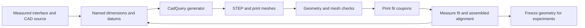

**How AI fits into this loop.** An assistant can help translate a dimension table into parametric code, inspect boolean/loft errors, and generate validation scripts. It cannot establish a printed fit or a mechanically sound load path from a plausible rendering. Those require inspection, measurements, and physical trials. The repository establishes the CAD workflow; it does not preserve enough prompt history to attribute every modeling operation to a particular assistant.

The flange mating plane is the shared zero-height datum and the nominal tool tip lies 42 mm below it. The M8/M10/M12 tool shaft across-flats dimensions are 6/8/10 mm. The hardware chamfers are deliberately larger and more printable than the original simulation tip geometry.

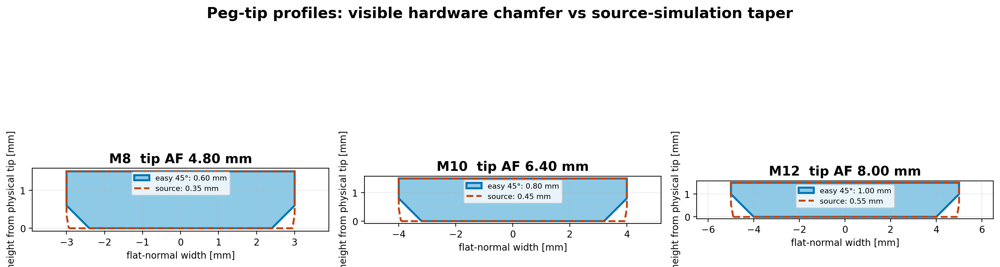

*Solid hardware profiles and dashed simulation profiles expose a real experimental difference. A wider physical entry geometry can improve capture; it must not be presented as evidence that the learned model itself improved.*

An early quick-change design encountered a printing problem at an unsupported shoulder and concerns about fit/hysteresis. The design moved to a solid integrated flange/tool. A separate mesh issue appeared when generic loft construction produced self-intersections for rotated variants; explicit planar faces provided a more inspectable construction. These examples show why rendering, mesh validity, printability, and installed mechanical behavior are separate checks.

| Artifact | What it lets a reader inspect |
|---|---|
| [Tooling design notes](real_device/model/parametric_tooling/README.md) | Datums, dimensions, print variants, and design history |
| [Parameters](real_device/model/parametric_tooling/design_parameters.json) and [generator](real_device/model/parametric_tooling/generate_models.py) | How geometry is specified and constructed |
| [M8 STEP](real_device/model/parametric_tooling/generated/integrated_flange_peg_m8.step), [M10 STEP](real_device/model/parametric_tooling/generated/integrated_flange_peg_m10.step), [M12 STEP](real_device/model/parametric_tooling/generated/integrated_flange_peg_m12.step) | The integrated tools |
| [Socket fixture STEP](real_device/model/parametric_tooling/generated/socket_base_hardware_easy_v2.step) | The easier hardware fixture geometry |
| [Mesh checker](real_device/model/parametric_tooling/verify_print_meshes.py) and [validation output](real_device/model/parametric_tooling/generated/mesh_validation.json) | Stored mesh-level checks |
| [CAD manifest](real_device/model/parametric_tooling/generated/manifest.json) | Generated artifact and geometry provenance |

<details>
<summary>Coordinate-frame lesson: a CAD rotation must not be compensated twice</summary>

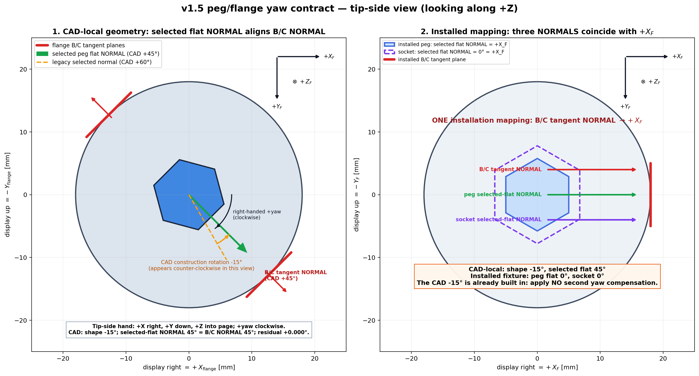

The documented -15-degree CAD construction rotation is already part of the geometry. Applying another correction at runtime would change the intended alignment. CAD datums, fixture alignment, robot TCP, and force/torque sensor axes must be related explicitly. A geometric drawing does not itself calibrate the installed sensor or establish the measured tool pose.

</details>

**What I would improve.** Print fit coupons before full tools; record measured dimensions, insertion clearance, runout, installed yaw, and TCP uncertainty. Freeze the geometry version before collecting a comparison dataset. To regenerate, use an isolated copy and the environment instructions in the tooling README: the generator also manages retired outputs. A watertight mesh is a file-quality result, not a certificate of fit, strength, or experimental equivalence.

## 6. Connect models, software, and hardware

### What actually runs on the robot

The apparatus uses a KUKA LBR iiwa 14 R820, KST/Sunrise communication, and a Bota force/torque sensing path through ROS. MATLAB owns online motion commands and the engagement state machine. The Python runtime performs a phase-boundary inference job after a completed probe; it does not connect to ROS, Bota, KST, or the robot.

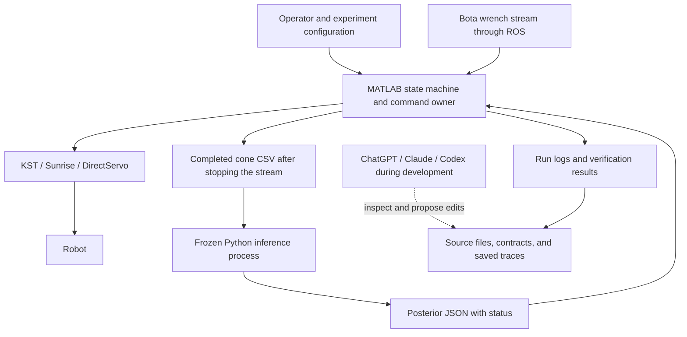

During the documented DirectServo stream, synchronous KST pose feedback is unavailable. Commanded or interpolated pose samples must not be called continuously measured robot trajectories. Fresh state checks before and after a stream, wrench timestamps, and explicit signal labels are necessary to interpret a run.

The real-device model uses seven channels across 360 phase samples: six world-frame relative wrench channels plus commanded relative vertical displacement. Five context values encode size, target force, and bit ratio. The documented runtime is `REAL_FOURIER_LINEAR_V1`, with three seeds trained on 48 clean runs selected from 78 acquired cones. This is different from the four-channel simulation CNN. Runtime authority remains limited: the M12 shortcut is capped, and narrow M10 pilot exceptions do not establish general deployment across sizes.

Implementation and contracts: [MATLAB policy](real_device/execute_m12_contact_engagement_policy.m), [runtime README](real_device/model_runtime/README.md), and [hardware README](real_device/README.md).

### How ChatGPT or Claude can help read a hardware interface

There are two distinct activities: an assistant inspecting a workstation's source/docs/logs, and a controller communicating with hardware. The repository documents the second activity in code and logs. It does **not** establish a verified, product-specific live ChatGPT or Claude robot bridge.

A useful development workflow is still concrete:

1. Give the assistant the driver/interface documentation, the relevant source, and a saved trace. Ask for inputs, outputs, units, frames, timestamps, blocking behavior, and failure states.
2. Ask it to trace one signal end to end: for example, sensor wrench → frame transformation → probe CSV → model features → posterior JSON → bounded command.
3. Compare its explanation with a known static reading and an offline replay. Inspect the actual executable path, dependencies, and loaded model before motion starts.
4. Make one reviewed software change and assess it with the existing controller and operator procedure. Record what changed and whether the predicted symptom changed.

For a future integration, a small **read-only tool adapter** could expose `read_interface_contract`, `get_cached_status`, `read_run_trace`, and `replay_saved_cone`. Each response should include provenance, freshness, units, frames, and error status. This is a proposed interface, not a checked-in functioning bridge. It would let an assistant explain evidence without turning conversational suggestions into robot commands. The [workbook](docs/AI_ASSISTED_RESEARCH.md#proposed-read-only-hardware-tools) gives example contracts.

### What the hardware evidence currently supports

The hardware records include three groups of 26 conical acquisitions, named M12 method runs, and two M10 fixed-start pilots. They support mechanism inspection and reveal deployment failures; they do not establish randomized population success rates or seamless simulation-to-real transfer. Some records distinguish `success=false` from `task_completed=true`, so endpoint definitions and time limits must be read before classifying a run.

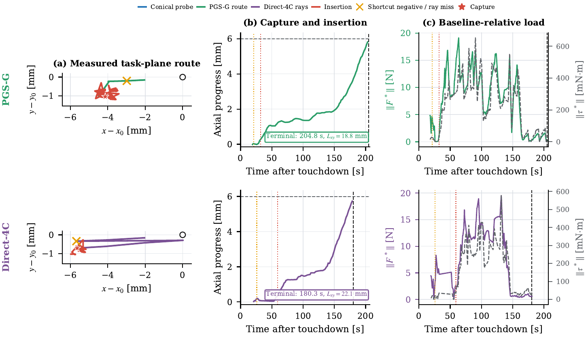

*This named same-start mechanism example uses extended runs, with terminal times around 204.8 s and 180.3 s. It is not the 130 s simulation benchmark and should not be used to claim success within that budget.*

**What I would improve.** Establish sensor bias/gravity compensation, moment reference points, installed frames, timestamps, and command ownership before judging model quality. Validate a saved cone in the exact deployment environment. Use a small, fixed set of hardware starts and change one component at a time. Save the controller revision, model/configuration hashes, environment information, and geometry identifier before every run.

## 7. Lessons from iteration

The most useful AI-assisted debugging is a loop: state competing explanations, find a discriminating measurement, make one change, and check whether the predicted effect occurs. The examples below show how implementation and experimental choices became more precise through that process.

| Recorded problem | What the evidence changed | Lesson and a better next experiment |
|---|---|---|
| An early direct/Jin-style comparison used injected direction errors and true offset distance | The comparison did not match the information available to competing methods; a corrected selected case could favor Direct | Freeze an information-access table and paired starts before making a superiority claim |
| A more elaborate information-driven planner looked attractive | The final paired evidence did not establish a clear extra benefit over PGS-O | Require an ablation that shows when the added term changes an action and improves an outcome |
| A recoverable low-force event during RAMP invalidated a whole probe | A non-SCAN event could suppress the shortcut | Define validity per acquisition phase and replay the recorded state transitions |
| A hardware run invoked `/usr/bin/python3`, where the required model dependency failed | The apparent learned-policy run actually used a classical cue fallback | Check interpreter and model loading before deployment; log model identity and avoid silent fallback |
| A direct ray missed the target | The logged ray already travelled about 4.218 mm; direction error was more relevant than insufficient length | Reconstruct direction and coordinate conventions before increasing the motion limit |
| Broad stability and reachability checks distorted behavior | A force-stable window could return too early; an old grid veto could report false exhaustion | Test each state transition against a trace and keep diagnostic cues separate from terminal verification |
| Offline replay exposed inconsistent model direction | Recorded force differed from training context; gravity/CoM and moment-origin effects remained plausible nuisance causes | Measure the sensing chain and use same-pose air/contact checks before tuning thresholds |
| A printed quick-change part and some generated meshes failed | CAD appearance had hidden print-support, fit, and topology problems | Use coupons, physical inspection, and independent mesh checks before freezing the tooling |

The hardware examples are documented in [M12 three-run debugging](real_device/docs/M12_20260727_THREE_RUN_DEBUG.md). Simulation comparison changes and reasoning constraints are recorded in [design decisions](mujoco_unscrewing_probe_new/DESIGN_DECISIONS.md) and [project rules and lessons](mujoco_unscrewing_probe_new/PROJECT_RULES_AND_LESSONS.md). Each record identifies the conditions and scope of the corresponding check.

For every failure, I would now preserve a short **prediction → observation → explanation → discriminating test → result** note. AI can suggest alternatives and inspect logs. The researcher should select the test, predict its outcome before running it, and explain why the result changes the conclusion.

## 8. Make the contribution and learning explicit

### What this project contributes at the system level

The concrete work is a connected research system: an informative contact probe; a direction-to-centre inference interface that retains radial ambiguity; a bounded shortcut with residual search; independent engagement checks; paired simulation evidence; and printed tooling plus hardware deployment records. Counterexamples and negative findings help explain when each component is useful and where further research is needed.

The central contribution is the connection between partial tactile information and a bounded physical action, evaluated within a shared control and verification framework. The literature comparison and experiments define the scope of that contribution.

### Author's role, research decisions, and engineering work

My contribution centers on developing and evaluating the connection between the physical task, tactile inference, planning, and hardware execution. This involved problem framing, experimental choices, implementation and integration, physical tooling, and interpretation of results. AI assistance supported parts of this work, as described above. The clearest way to present my role is through the technical decisions and artifacts that make the system inspectable.

| Area | Work represented in this project | Research judgment and responsibility |
|---|---|---|
| Problem framing | Engagement isolated from the broader unscrewing task | Choose a measurable endpoint and identify the direction-distance ambiguity |
| Method development | Tactile posterior, bounded shortcut, and residual search | Connect uncertain information to limited motion while retaining physical verification |
| Simulation and evaluation | Paired M8 trials, representation comparisons, recovery studies, and cross-size checks | Match information and budgets, inspect trajectories, and interpret both positive and negative results |
| Mechanical implementation | Parametric tools, fixture geometry, fit variants, and mesh checks | Relate CAD choices to printability, alignment, and contact behavior |
| Hardware integration | Probe acquisition, runtime inference, controller interfaces, and recorded trials | Trace signals through the installed system and diagnose deployment issues |
| Research communication | Code, data, figures, design records, and reproduction instructions | Make claims traceable and distinguish demonstrated behavior from future extensions |

The next step is to strengthen these contributions through independently worked derivations, focused mechanism experiments, and a decision log that records predictions before results are observed. This makes personal research judgment visible alongside the implemented system.

### Priorities for deeper understanding and further research

**Theory.** Develop an observability analysis of the probe: which contact features identify direction or distance, and how do geometry and gravity affect them? Connect classifier calibration to centre-belief coverage, analyze the conditions behind action bounds, and study the sampled compliant controller with explicit assumptions.

**Engineering.** Extend the measurement and deployment workflow with installed-frame calibration, explicit wrench reference points, timing checks, and geometry versioning. A successful repeat run should be accompanied by a clear explanation of the physical cause and the effect of the change.

**Evidence and communication.** Freeze comparison contracts and held-out evaluations early, report failures and budgets consistently, and maintain source-to-figure traceability. Use focused ablations to establish which component produces an improvement and preserve negative results that guide the next design choice.

## If I repeated this project

I would keep the physical question narrow and make learning deliverables part of the experiment plan. Each stage would end with something I can explain and reproduce independently.

| Stage | What I would do first myself | How I would then use AI | Evidence of understanding before moving on |
|---|---|---|---|
| 1. Define the task | Draw the contact geometry and write failure hypotheses | Challenge the framing and identify missing variables | Explain the endpoint and a result that would refute the hypothesis |
| 2. Read the foundations | Read a small set of primary papers and derive one central result | Compare assumptions and critique my synthesis | Reproduce a toy result and explain how this apparatus differs |
| 3. Build a minimal model | Implement a small geometry/posterior example without a network | Review dimensions, edge cases, and numerical behavior | Predict outcomes for ambiguous, reversed, and mismatched inputs |
| 4. Design the experiment | Freeze baselines, information access, splits, and metrics | Audit leakage and propose discriminating ablations | Explain what each ablation could prove and what it could not |
| 5. Establish the hardware chain | Measure frames, bias, geometry, timing, and fit | Inspect contracts and automate bounded checks | Trace one physical wrench reading all the way to a bounded command |
| 6. Add learning | State exactly what the classical method cannot resolve | Help implement and evaluate the smallest useful model | Show an improvement attributable to learning under matched conditions |
| 7. Analyze failure | Predict competing causes and choose one measurement | Generate alternatives and review the evidence | Explain why a test supports one cause over another |
| 8. Write the claim | Draft the argument from figures and counterexamples | Critique clarity, scope, and missing support | Defend each claim from a concrete artifact without relying on AI prose |

### Build a connected knowledge system

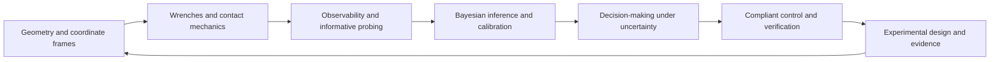

For each connection, I would write one page containing an intuition, a derivation, a small executable example, a measured or simulated counterexample, and a link to the project component it explains. For example, changing the moment reference point connects rigid-body mechanics directly to feature distribution shift; a bimodal direction estimate connects calibration directly to a shorter action; finite search boundaries connect geometry directly to limits on coverage claims.

Three especially useful independent exercises would be:

1. **Wrench exercise:** derive and numerically check a force/torque frame and reference-point transformation, then predict the effect of a sign or origin error on a probe fingerprint.
2. **Belief exercise:** build a tiny particle posterior with synthetic observations, compare its predicted mass with empirical coverage, and show why direction confidence alone does not determine distance.
3. **Control/evidence exercise:** replay a failed run, distinguish commanded state, observed wrench, inference output, and verification events, and propose one test whose result would change the diagnosis.

I would revisit these exercises later without an assistant or the earlier solution. Being able to transfer the idea to a new geometry, sensor condition, or failure is a stronger learning check than recognizing a familiar explanation. The [workbook](docs/AI_ASSISTED_RESEARCH.md) turns this plan into practical prompts and templates.

## Repository, data, and reproduction

### Where to start

| Content | Entry point |
|---|---|
| Paper and source | [Manuscript PDF](overleaf_unscrewing/main.pdf), [LaTeX](overleaf_unscrewing/main.tex), [bibliography](overleaf_unscrewing/references.bib) |
| Figure/result provenance | [REPRODUCIBILITY.md](REPRODUCIBILITY.md) |
| Simulation and planning | [Simulation workspace](mujoco_unscrewing_probe_new), [posterior planner](mujoco_unscrewing_probe_new/src/posterior_search_plan.py), [comparison executor](mujoco_unscrewing_probe_new/src/render_m8_search_comparison.py) |
| Hardware and inference | [Real-device workspace](real_device), [runtime contract](real_device/model_runtime/README.md) |
| CAD and print files | [Parametric tooling](real_device/model/parametric_tooling/README.md) |
| Experiment videos | [Animated gallery](docs/MEDIA_GALLERY.md), [full MP4 downloads](https://github.com/nanjinyao/tactile-posterior-guided-engagement/releases/tag/media-gallery-2026-10-28) |
| Research reflection | [AI-assisted research workbook](docs/AI_ASSISTED_RESEARCH.md) |
| Snapshot scope and checks | [Snapshot notes](docs/GITHUB_SNAPSHOT.md), [upload validation](docs/VALIDATION_20261027.md), [historical audit](PUBLICATION_AUDIT.md) |

### Download the data and models

Code, documentation, figures, and smaller artifacts are tracked in Git. Larger/binary scientific artifacts are stored in six Release archives: datasets, diagnostics, evaluations, hardware, models, and videos. The [manifest](docs/SNAPSHOT_MANIFEST.json) records their paths, sizes, and SHA-256 hashes. Both the repository and Release downloads are publicly accessible.

With GitHub CLI authenticated and Python 3.10+ available:

```bash
gh repo clone nanjinyao/tactile-posterior-guided-engagement
cd tactile-posterior-guided-engagement
python tools/restore_artifacts.py --all
python tools/restore_artifacts.py --verify
```

For access without a GitHub account, clone with ordinary Git and download the six ZIP archives from the [Release page](https://github.com/nanjinyao/tactile-posterior-guided-engagement/releases/tag/research-snapshot-2026-10-27) into a local directory such as `../release-assets`:

```bash
git clone https://github.com/nanjinyao/tactile-posterior-guided-engagement.git
cd tactile-posterior-guided-engagement
python tools/restore_artifacts.py --all --local-assets ../release-assets
python tools/restore_artifacts.py --verify
```

To restore selected groups only:

```bash
python tools/restore_artifacts.py --group models datasets
```

`--verify` checks the entire manifest and will report missing files after a partial restore. The original scientific Release is [research-snapshot-2026-10-27](https://github.com/nanjinyao/tactile-posterior-guided-engagement/releases/tag/research-snapshot-2026-10-27); its tag and six archives remain fixed while the main branch receives documentation improvements.

### What has and has not been verified

The initial upload included archive/member integrity checks, a full restored-snapshot hash check, selected tests (**26 passed plus 29 subtests**), and the stored-paper evidence verifier. The documentation revision does not constitute a new simulation benchmark, model-training run, CAD fabrication, or hardware experiment. See the [dated validation record](docs/VALIDATION_20261027.md) for the exact scope.

Full reproduction still has limitations: the original environment lock is incomplete; KST is an external dependency; some hardware source hashes do not match the later available source; installed metrology is incomplete; historical native-library issues remain; and some composite figures require manual assembly. The stored results should be read with those limits. For environment and evidence-specific instructions, begin with [REPRODUCIBILITY.md](REPRODUCIBILITY.md) and the relevant subsystem README.

For a research report, cite the repository together with the commit used for the narrative and the frozen scientific Release tag. This preserves the distinction between an evolving explanation and the original experimental snapshot.
