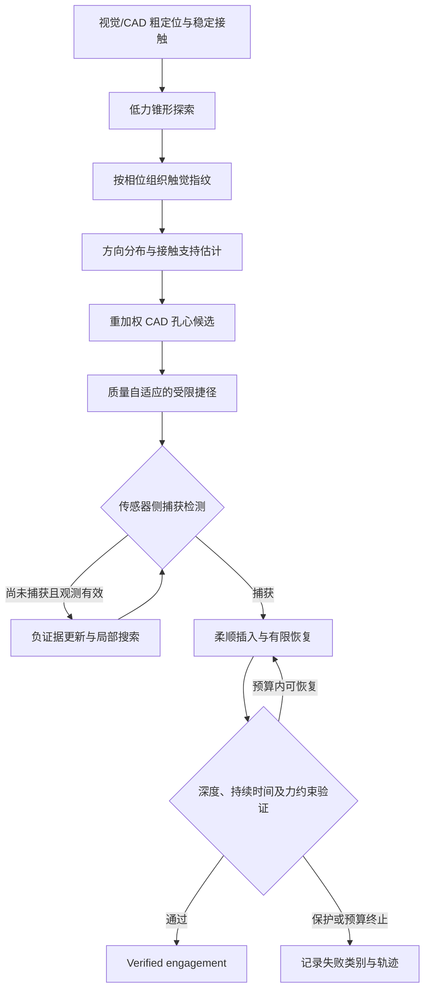

# Tactile Posterior-Guided Hex-Socket Engagement

**Learning-Based Tactile Posterior-Guided Search for Robotic Hex-Socket Engagement**

通过一次低力锥形探索，把触觉信号转化为方向后验，再用受限捷径和局部搜索完成机器人内六角接合。
本仓库保存核心仿真代码、实机控制与离线学习代码、原始记录、模型、论文和展示材料。
研究终点是**经独立验证的几何接合**，尚未覆盖旋转拧松、螺纹释放和螺钉取出。

这是作者的**私有研究快照**；论文为双匿名工作稿，尚未指定项目级开源许可证。
本次上传范围、验证结果与历史审计的区别见 [GITHUB_SNAPSHOT.md](docs/GITHUB_SNAPSHOT.md)。


## 阅读入口

| 内容 | 入口 |
|---|---|
| 研究动机与算法 | 下方“研究问题”和“核心思路” |
| 论文全文 | [LaTeX](overleaf_unscrewing/main.tex)、[PDF](overleaf_unscrewing/main.pdf) |
| 每张图、每个结果的来源 | [REPRODUCIBILITY.md](REPRODUCIBILITY.md) |
| 仿真算法 | [后验搜索规划](mujoco_unscrewing_probe_new/src/posterior_search_plan.py)、[搜索执行器](mujoco_unscrewing_probe_new/src/render_m8_search_comparison.py) |
| 实机执行和部署 | [实机说明](real_device/README.md)、[推理运行时](real_device/model_runtime/README.md) |
| 数据与模型获取 | 下方“数据下载与校验” |
| 汇报材料 | [39 页精简版](outputs/Learning_Based_Tactile_Posterior_Guided_Search_Compact_39_Slides.pptx)、[讨论版](outputs/Learning_Based_Tactile_Posterior_Guided_Search_Group_Review.pptx) |

## 研究问题

视觉和 CAD 能把工具带到螺钉附近，但剩余的毫米级平面误差仍可能超过倒角捕获范围。
直接下压容易顶在螺钉表面；从头执行全局外扩螺旋又会重复走过已有接触信息排除的位置。

一次锥形接触通常能较好指示“孔心在哪个方向”，却不足以稳定确定“还差多远”。
直接把学习结果当作准确孔心，会把径向不确定性隐藏进动作。
本项目保留这部分不确定性：模型提供方向和接触支持，规划器分配移动预算，物理控制器判断是否真正接合。

## 核心思路



### 1. 主动探索与触觉指纹

工具在稳定接触后进行约 15° 的低力锥形运动。仿真观测为轴向力、两个弯矩与工具尖端高度：

$$y(\phi)=[F_z(\phi),\tau_x(\phi),\tau_y(\phi),z_{tip}(\phi)]^T.$$

各通道按圆周相位周期插值为 360 个点，形成 `4 × 360` 输入。
探索相位 $\phi$ 与工具到孔心的方向角 $\theta$ 是不同变量；高度通道不单独承担插入成功判定。
对应代码：[观测](mujoco_unscrewing_probe_new/src/wrench_observation.py)、[训练](mujoco_unscrewing_probe_new/src/train_m8_direction_models.py)、[推理](mujoco_unscrewing_probe_new/src/m8_direction_runtime.py)。

### 2. 预测方向分布与观测质量

仿真使用三个独立训练的圆周 CNN，在 48 个方向区间上输出经温度标定的概率并取平均。
圆周均值给出方向；集中度、成员分歧、预测集合和熵描述不确定性；另一个输出估计接触支持状态。

实机采用单独构建的真实数据接口：七通道输入、选定的 `REAL_FOURIER_LINEAR_V1` 模型与 TOP1 路由。
七通道为六维力/力矩及相对指令高度，不能当作上述四通道 CNN 的直接部署。
见 [common.py](real_device/offline_learning/common.py) 与[实机模型说明](real_device/model_runtime/bundles/real_multisize_direction_v1/README.md)。

### 3. 将触觉信息融合进孔心后验

从视觉/CAD 的有限先验区域采样孔心候选，结合候选方位、方向概率及接触支持相关的径向似然重加权。
论文 M8 使用 4096 个候选，视觉标准差 2 mm，截断半径 4.895 mm。
这种表示保留同一方向上的距离歧义；小的均匀似然项避免一次模糊观测完全抹去几何支持。

实际移动终点有效、接触状态满足条件但没有捕获时，使用 miss 观测降低相关区域的权重并重新规划。
未执行或没有有效终点的指令不能作为排除某区域的证据。

### 4. 用后验分位数限制捷径长度

将候选孔心相对当前位置的位移投影到预测方向得到 $z_j$，以质量 $q$ 决定允许消耗的后验低分位数和径向预算：

$$L^*=\min\{[Q_{\alpha(q)}(z)-0.25r_{eff}]_+,\;\lambda(q)Q_\rho(\|C-x_0\|),\;L_c\}.$$

其中 $\alpha(q)=0.10+0.15q$、$\lambda(q)=0.35+0.30q$。
方向分散、成员不一致或反向质量较大时，捷径缩短；投影非正的后验质量达到 0.20 时不执行捷径。
论文使用 $\rho=0.99$，通用规划函数默认 0.95，实验以调用参数和冻结任务合同为准。
后验预算约束只涉及候选集，不构成物理捕获保证。
实现：[plan_posterior_guided_search](mujoco_unscrewing_probe_new/src/posterior_search_plan.py)。


### 5. 搜索剩余区域

| 策略 | 行为 | 冻结记录标识 |
|---|---|---|
| PGS-O | 后验捷径 + 有限局部外扩螺旋 | `proposed` |
| PGS-G | 后验捷径 + 信息增益、捕获概率与移动代价驱动的网格搜索 | `proposed_plus` |
| Outward | 从初始点执行全局外扩螺旋 | `outward` |
| Direct-4C | 四通道预测 + 最多三次同一 rollout 内的直接尝试 | `improved_direct_retry3` |
| Direct-3C | Jin 风格三通道工程代理 + 有限重试 | `jin_direct_retry3` |

PGS-G 结合 hit/miss 的期望信息增益、可能覆盖的捕获区域与移动成本；信息价值不足时回到覆盖搜索。
有限螺旋的节距约束不是整个有限边界区域的覆盖证书。
三次直接尝试属于同一试验内的重试；Direct-3C 是工程代理，不能据此声称复现原论文。
实现：[网格策略](mujoco_unscrewing_probe_new/src/entropy_grid_baseline.py)、[统一评估](mujoco_unscrewing_probe_new/src/run_m8_five_method_retry3_audit.py)。

### 6. 用共享物理闭环验证接合

所有搜索方法共享导纳/RCC 控制、力和倾角约束、捕获检测、恢复和终止验证。
捕获只触发插入尝试；达到注册深度并持续满足驻留时间及保护条件后，才记录 verified engagement。
停滞或姿态不合适时可卸载、回撤、回正、重新接触，最多恢复三次。
实现：[导纳](mujoco_unscrewing_probe_new/src/cartesian_admittance.py)、[物理执行](mujoco_unscrewing_probe_new/src/mujoco_admittance_rollout.py)、[恢复保护](mujoco_unscrewing_probe_new/src/funnel_guard.py)、[终止验证](mujoco_unscrewing_probe_new/src/terminal_completion_verifier.py)。

## 当前结果

来源：[冻结报告](mujoco_unscrewing_probe_new/outputs/current/evaluations/m8_five_method_retry3_r3_closed_loop/report.json)及同目录逐试验 `trials/sobol_*.json`。
24 个配对 M8 初始任务，共享 130 s 预算。时间、路径和接触功代理为**各自成功子集**的中位数。

| 方法 | 验证接合 | 时间 / s | 路径 / mm | 接触功代理 / mJ |
|---|---:|---:|---:|---:|
| PGS-O | 20/24 | 13.87 | 14.52 | 28.48 |
| PGS-G | 19/24 | 13.74 | 6.76 | 9.54 |
| Outward | 19/24 | 34.63 | 71.27 | 120.38 |
| Direct-4C | 17/24 | 9.22 | 6.07 | 13.67 |
| Direct-3C | 16/24 | 8.96 | 5.67 | 13.22 |

- PGS-O 与 Outward 共同成功的 19 例中，PGS-O 路径全部更短，配对路径差中位数为 **−41.14 mm**。
- PGS-G 与 PGS-O 的配对结果未显示网格策略的明确额外优势，不能把收益单独归因于信息增益。
- 独立的 12 例恢复压力集中，相同 RCC/保护下关闭恢复为 **0/12**，允许三次恢复为 **9/12**。
- M10/M12 跨尺寸结果混合：微调在未触及测试集上未稳定优于零样本或仅标定，M10 硬停止门槛未通过。
- 实机包括三种尺寸各 26 次、共 78 次锥形采集，以及命名 M12 方法运行与两个 M10 固定起点 pilot。采集次数不是任务成功次数；命名运行不是随机总体成功率基准。

实机记录可能同时有 `task_completed=true`、`success=false`，应结合事件、深度及预算解释。
当前实机代码与部分命名运行的源代码哈希未完全对应；完整限制见审计。

## 数据下载与校验

普通克隆包括代码、JSON/CSV 报告、实机原始 CSV、论文、图与两份选定 PPTX。
仿真 NPZ、PT 权重、视频和大型 CSV 按类别放在同仓库的
[research-snapshot-2026-10-27 私有 Release](https://github.com/nanjinyao/tactile-posterior-guided-engagement/releases/tag/research-snapshot-2026-10-27)。

```bash
git clone https://github.com/nanjinyao/tactile-posterior-guided-engagement.git
cd tactile-posterior-guided-engagement
gh auth login
python tools/restore_artifacts.py --group models datasets
# 恢复全部材料，包括评估样本、大型诊断轨迹与视频
python tools/restore_artifacts.py --all
# 检查主仓库文件与已还原数据
python tools/restore_artifacts.py --verify
```

| 数据分组 | 内容 |
|---|---|
| `models` | 仿真模型权重与归一化参数 |
| `datasets` | 仿真训练、标定及适配数据 |
| `evaluations` | 冻结评估中的二进制样本与权重 |
| `diagnostics` | 诊断样本和大型接触轨迹 |
| `hardware` | 实机离线学习与部署的二进制数据/权重 |
| `videos` | 保留的演示视频 |

仅准备实机离线推理时可先执行 `python tools/restore_artifacts.py --group hardware`。
下载需要该私有仓库的访问权限及已登录的 GitHub CLI。
还原脚本核对压缩包和逐文件 SHA-256，保留原始相对路径，默认拒绝覆盖内容不同的现有文件。
完整清单见 [SNAPSHOT_MANIFEST.json](docs/SNAPSHOT_MANIFEST.json)，大文件不通过 Git LFS 分发。
原始数据、合同和权重不作内容改写。

主仓库可直接执行关键记录验证，不需要安装仿真依赖或下载大数据：

```bash
python tools/verify_paper_evidence.py
```

这只检查已存记录和部分数值，不重新执行实验。

## 目录与复现路径

| 路径 | 内容 |
|---|---|
| `mujoco_unscrewing_probe_new/src/` | 仿真、学习、规划、控制、评估、渲染 |
| `mujoco_unscrewing_probe_new/configs/`、`models/` | 三尺寸几何与 MuJoCo 模型 |
| `mujoco_unscrewing_probe_new/outputs/current/` | 冻结数据、权重、报告、逐试验记录和媒体 |
| `real_device/` | MATLAB 控制器、任务入口、安装配置、CAD 与原始实机 CSV |
| `real_device/offline_learning/`、`offline_analysis/` | 真实数据构建、训练、标定与保留结果 |
| `real_device/model_runtime/` | 推理接口、模型包及部署合同 |
| `overleaf_unscrewing/` | 当前论文、10 张图、参考文献及构图代码 |
| `outputs/` | 精简版与讨论版汇报 PPTX |
| `docs/`、`tools/` | 清单、验证记录、下载还原及证据检查工具 |

论文以当前文件快照导入，原独立 `.git` 保留在本机。第三方论文 PDF、独立参考项目、重复的 1.32 GB 演示文件、同步冲突、本机环境与临时目录未纳入上传。
仿真历史依赖锁未完整找到；根 `requirements.txt` 是直接依赖列表，实机保留自己的 Python 3.8 锁文件。

```bash
python -m venv .venv
# Linux/macOS；PowerShell 改用 .\.venv\Scripts\Activate.ps1
source .venv/bin/activate
python -m pip install -r requirements.txt
cd mujoco_unscrewing_probe_new
python -m pytest -q -p no:cacheprovider tests/test_posterior_search_plan.py tests/test_cartesian_admittance.py tests/test_terminal_completion_verifier.py tests/test_checkpoint_relocation.py
```

还原模型和数据后，在合格的 MuJoCo/PyTorch 环境中运行完整五方法实验：

```bash
python -m src.run_m8_five_method_retry3_audit --help
python -m src.run_m8_five_method_retry3_audit --poses 24 --workers 1 --no-resume --output outputs/reproduction/m8_five_method
```

S4 跨尺寸执行需要 Unix `fcntl`，视频依赖 FFmpeg。部分训练/消融默认写入保留结果目录，应在独立副本运行。
本次上传未连接机器人、重训模型或重跑完整物理基准。
逐图逐表来源、实机依赖、论文编译、已知 Windows 原生依赖问题与命令限制详见 [REPRODUCIBILITY.md](REPRODUCIBILITY.md)。
项目尚无最终出版元数据和项目级许可证，不生成虚构的 DOI/正式引用；私有上传不授予公开再分发许可。


历史英文仓库准备说明保存在 [REPOSITORY_PREPARATION_20260917.md](docs/REPOSITORY_PREPARATION_20260917.md)。
