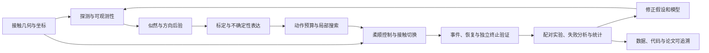

# AI 辅助研究：本项目的协作记录、重做方案与知识体系

本项目较有价值的研究接口是：用主动接触获取方向信息，保留距离歧义，再把不确定性转成有限动作和独立验证。
重做时应保留这个物理主线，并改善问题收敛、机制消融、证据管理和个人学习。
本文将**历史记录能确认的事实**与**下一次建议采用的方法**分开说明；建议尚未作为新实验执行。

## 一、AI 在这里分别指什么

| 对象 | 作用 | 应如何验证 |
|---|---|---|
| 开发阶段的大语言模型助手 | 阅读整理、提出候选路线、解释公式、辅助实现、查错、分析和写作 | 原始来源、手工推导、代码差异、实际命令和实验记录 |
| 机器人运行时的学习模型 | 把触觉指纹映射为方向与接触支持，供规划使用 | 数据划分、标定、运行时合同、离线推理和任务级评估 |
| 研究者 | 决定问题、假设、比较标准与结论，解释物理行为 | 能独立说明为什么这样设计，以及什么证据会推翻它 |

大语言模型给出的文本不能充当实验观测。训练模型输出的高置信度也不能充当物理接合证明。
仿真四通道 CNN 与实机七通道 Fourier 接口的具体区别见[根 README](../README.md)。

### 可以确认的协作历史

1. [DESIGN_DECISIONS.md](../mujoco_unscrewing_probe_new/DESIGN_DECISIONS.md) 的 `2026-07-09 23:23` 条目明确记录：ChatGPT 讨论提出了多尺寸、几何搜索、接触推理、锥形探索和信息增益等路线；实际近期任务随后收敛为 M8-first，先明确采样、标签、模型、结果和动作连接。
2. 本机 `project_trace.md` 的 `2026-06-24 03:26:28 +08:00` 条目记录了对 Claude 建议的选择性采纳，包括符号与坐标分离、联合转移的 Bayes 更新、规划层次表述和信息增益的预测观测分布。该日志未纳入 GitHub 初始快照，因此这里明确给出来源和内容摘要，而不提供失效链接。这属于早期阅读材料的修订记录，不代表当前方法实现了其中所有设想。
3. [PROJECT_RULES_AND_LESSONS.md](../mujoco_unscrewing_probe_new/PROJECT_RULES_AND_LESSONS.md) 与设计决策保留了针对真值泄漏、事件标签、观测与终止验证混淆、基线偏置、实际轨迹和实验边界的修正规则。它们能证明这些问题被记录并处理过，但不能逐项证明由哪个 AI 首先发现。
4. 2026-10-27 的仓库准备、详细 README、清单、还原工具和校验由当前 Codex 协作会话完成。实际执行及其局限见 [VALIDATION_20261027.md](VALIDATION_20261027.md)。本次没有重新训练模型、运行完整物理基准或连接机器人。

没有完整历史对话导出、逐文件 AI 贡献标记、所有模型版本和准确用时，因此不宣称“项目由某个 AI 自动完成”，也不估算节省比例。下文提示词全部是新编的工作模板。

## 二、怎样把 AI 辅助落到具体研究步骤

### 1. 先提供问题与证据，再请求方案

每次开始一个子任务，提供一个短的上下文包：当前问题、输入/输出、坐标与单位、已知结果、证据路径、不能改的条件、期望交付物。
例如讨论捷径规划时，应提供后验样本、预测方向、有效捕获半径和命令上限；只说“优化成功率”不足以判断该改观测、规划还是控制。

```text
当前问题：方向预测可用，但径向距离仍不确定。
已知接口：输入孔心候选、方向及质量，输出有限平移和残余搜索半径。
约束：在线不能读取真实孔心；保留共享控制、终止验证与原始数据。
证据：请先读取指定源文件、冻结任务合同和一个失败记录。
交付：列出已知事实/假设/未知，提出两个可区分的解释和最小区分实验。
不要在缺少观测时把候选解释写成结论。
```

### 2. 用 AI 做阅读结构化，自己核对关键论证

让助手为每篇原始材料提取“任务—假设—可观测量—动作—指标—失败条件”，并指出可迁移到本项目的部分。
重要公式要求给出变量维度、坐标系、条件概率的条件和采用的近似；重要结论回到原始文献的具体位置核对。
项目中的设计决策是阅读后的取舍记录，不等于外部论文事实的替代来源。

```text
依据我提供的论文内容解释方法，不补造引用。
对每个准备借用的公式写明：原假设、本项目是否满足、缺失的观测、最小验证。
把“论文直接给出”“由此推断”“本项目的新假设”分别标明。
最后出三道需要推导或举反例的问题，先不要给答案。
```

### 3. 把实现任务缩到一个清楚的接口

先写输入、输出和不变量，再让助手实现。对本项目，后验搜索规划就是合适边界：可以检查零方向、反向后验质量、有限步长和残余半径，而不同时重写感知与硬件控制。
研究者需要读懂修改差异和失败分支，确认采用的是实际状态还是指令状态，以及真值是否只用于离线评分。

```text
只修改后验到动作的规划函数。
先说明单位、输入形状、哪些参数来自调用者、什么情况应返回零捷径。
说明一个正常例子和一个反向质量过大的反例，再给最小修改。
验证应覆盖实际行为差异，保留冻结证据；报告执行过的命令和未验证部分。
```

### 4. 用原始轨迹诊断，避免只看视频和摘要

给助手一个具体失败 ID，要求对齐命令、测量位姿、力/力矩、状态切换与时间预算。
让它提出竞争解释，例如“方向错”“捕获漏检”“工具外壁下滑”“切换产生力突变”，并逐项指出支持和反对证据。
视频用于理解过程，定量结论仍需来自实际轨迹、事件和统一终止规则。

```text
请分析指定 trial，按时间列出：探测结束、平移、首次候选捕获、恢复、终止。
区分指令轨迹/实测轨迹、候选捕获/最终接合。
为每个候选原因给出可观测判据；缺什么记录就明确说明。
最后只建议一个能区分主要解释的下一步改动。
```

### 5. 让助手组织实验，先检查比较是否回答问题

请求实验设计时，应要求写出“要区分的两种解释、控制变量、主要结果、失败类别、何时停止”。
审查时可切换为反方视角，但另一次模型回答仍不是独立实验或独立事实来源。
多个助手给出相似说法，不能代替原始来源、推导和数据。

```text
我要验证“捷径本身带来效率收益”。
请区分：整个策略对比、匹配探索成本的机制消融、只在成功子集上的比较。
设计最小实验，固定初始任务、观测、残余策略、控制和总预算。
明确什么结果会否定我的解释，并检查有没有测试集选择或真值泄漏。
```

### 6. 写作时让结论逐条绑定证据

为每条贡献建立“结论—数据—统计口径—适用条件—反证/未证部分”的对应关系。
例如 PGS-O 在共同成功任务中路径更短，是配对效率证据；这不能自动推出无条件总体效率、硬件安全性或完整拧松能力。
让 AI 先审查越界表述，再润色语言，能减少叙述和实现逐渐分离。

### 每次协作应留下什么

一次有效交付至少包含：问题、读取的证据、假设、修改差异、执行命令、结果、仍未知的部分、下一项可证伪问题。
下一次项目可保存如下简短记录；它是建议格式，尚未补造为历史记录：

```yaml
question: 本次要回答的一个研究问题
ai_role: 阅读整理 / 候选推导 / 实现 / 审查 / 写作
model_and_date: 能确认则记录，否则注明未知
human_prediction: 在看到输出前，我预期会发生什么
inputs: [源文件, 数据或论文位置, 当前配置]
assumptions: [采用的假设及原因]
change: 修改范围与 commit
validation: 实际命令、结果和原始记录
decision: 采纳 / 修改后采纳 / 拒绝，以及理由
learning: 我能独立解释的机制与仍不懂的问题
```

## 三、如果重做：先修正哪些过程

### 从项目记录中提取的具体改进

| 已观察到的问题 | 重做时的改进 | 形成的可检查产物 |
|---|---|---|
| 早期路线同时涉及多尺寸、复杂接触推理和多种规划 | 第一阶段只回答 M8 接合的一个瓶颈；扩展路线另存 | 一页问题定义与第一阶段退出标准 |
| 方向可估计不代表距离可估计 | 在训练前画等观测候选和径向歧义，验证探测信息 | 几何图、重复探测结果、方向/距离分开评估 |
| 历史基线有方向扰动注入、真距离使用或成本排除 | 控制器可见信息和预算从第一天写成合同 | 在线输入清单、成本清单、匹配任务合同 |
| 搜索、捕获、插入与最终验证曾交织 | 独立记录每个阶段的观测、允许动作及完成条件 | 状态转换表和分阶段失败分类 |
| 网格规划增加复杂度，但配对结果未显示明确额外收益 | 先检验额外观测的任务价值，再增加规划复杂度 | 匹配成本的网格/螺旋消融及停止条件 |
| 跨尺寸微调开发集表现没有稳定转化为测试优势 | 冻结数据用途与选择规则，测过的测试集标记为已消耗 | 分组 split、模型选择记录、新测试计划 |
| 实机源代码哈希与部分命名运行未完全对应 | 每次运行前自动保存源快照、依赖、配置和权重身份 | 不可变运行清单与源码包 |
| 原始环境锁不完整，图表与论文存在手工衔接 | 初期建立最小可运行环境，表格由统一数据导出 | 锁文件、环境 smoke、指标导出和图表来源 |

历史例子来自[设计决策](../mujoco_unscrewing_probe_new/DESIGN_DECISIONS.md)、[规则与经验](../mujoco_unscrewing_probe_new/PROJECT_RULES_AND_LESSONS.md)及[审计](../PUBLICATION_AUDIT.md)。不同日期的记录代表不同阶段，不应用旧阶段的数字替换当前冻结结果。

### 按成果推进的研究阶梯

| 阶段 | 必须回答的问题 | 最小工作与进入下一阶段的依据 |
|---|---|---|
| A：任务与物理瓶颈 | 工具为什么接合失败，隐藏变量是什么？ | 画几何与坐标，整理成功/失败原始例子，固定终点和预算；能用一句话说明瓶颈 |
| B：探测与可观测性 | 锥形运动究竟增加了什么信息？ | 小规模重复采样；比较静态与相位序列、方向变化与径向变化；有可重复的区分证据 |
| C：最小执行闭环 | 不依赖学习，如何测量搜索与接合？ | Outward 基线、实际轨迹、阶段日志和终止验证；已知失败能定位到阶段 |
| D：最小学习接口 | 简单模型是否已经足够？ | 从物理特征/Fourier 或小模型开始，与更复杂模型匹配划分和预算比较；输出有明确动作用途 |
| E：动作与机制消融 | 后验、捷径、残余搜索各带来什么？ | 固定共享执行核心，逐项消融；有收益和失败的证据，才保留复杂模块 |
| F：实机与尺寸变化 | 哪个假设在现实或新尺寸失效？ | 从已工作的执行核心和一个可解释改动出发，短试验、读轨迹、修订；部署前离线加载和推理 |
| G：论文与复现 | 读者能否从数据重建结论？ | 先生成结果表和证据映射，再写文字；独立副本可还原，未知环节明确列出 |

阶段可交错推进；这里的退出依据比固定周数更重要。实机迭代复用已验证的执行与日志核心，每次只改变一个可解释因素。
调试前的检查聚焦本次改动与运行依赖；接触帧、单位或硬约束改变时再扩大验证范围。本文不安排实际机器人运行。

### 让消融真正回答因果问题

下一次可按问题设计下面的比较，具体样本量应依据主要指标和所需精度确定，而不是把当前 24 个任务当通用充分规模：

- **探测价值：** 比较无探测、静态观测与相位序列，统一任务终点和总预算，显式计入探测时间。
- **捷径价值：** 给两组相同指纹与后验，固定残余策略和控制，只改变是否执行捷径。
- **CAD 径向似然价值：** 固定方向来源及其他规划，比较方向-only 与方向加软径向约束。
- **网格价值：** 匹配捷径、残余范围、控制和总预算，比较局部螺旋与网格；记录增加的观测、卸载和移动成本。
- **恢复价值：** 固定压力集及其适用范围，比较 R0/R3，并保留所有保护退出和失败，不能只展示可恢复例子。
- **迁移价值：** 预先冻结零样本、标定和微调的选择规则，使用按物理身份分组的独立测试；旧测试结果只作已消耗证据。

首先报告全部任务的接合与失败分布，再报告条件效率。共同成功子集可以回答“双方都能完成时谁更短”，但不能直接回答“整个策略总体期望成本更低”。
超时和未完成任务的处理应预先确定，例如另行报告固定预算内完成曲线；不能删掉失败后只比较好看的中位数。

## 四、把项目变成知识体系

知识体系应连接物理现象、数学对象、程序接口和实验结论。下面的图表示依赖关系，不表示当前系统实现了完整 POMDP 求解器或形式化稳定性证明。



### 每层学到什么，怎样检查自己真的懂

| 知识层 | 必须能解释的问题 | 自己完成的练习 | 项目入口 |
|---|---|---|---|
| 几何、坐标与对称性 | 力/力矩在哪个参考点？六重对称如何影响方向和标签？ | 手画坐标变换、力矩换点与单位；给出旋转 60° 后预期信号/标签变化 | [wrench_observation.py](../mujoco_unscrewing_probe_new/src/wrench_observation.py)、[实机说明](../real_device/README.md) |
| 主动感知与可观测性 | 为什么运动序列比一次静态读数更有用？为什么方向可辨而半径仍模糊？ | 画两个同方位不同半径候选，预测哪些通道相似，设计一个区分动作 | [锥形设计](../mujoco_unscrewing_probe_new/docs/M8_CONICAL_PROBE_STATE_TRANSITION_DESIGN.md) |
| 概率与 Bayes 更新 | 后验用了哪些条件？miss 在什么观测条件下才有意义？ | 手算四个孔心候选的一次更新，改变似然后解释结果 | [entropy_grid_baseline.py](../mujoco_unscrewing_probe_new/src/entropy_grid_baseline.py) |
| 圆周统计、标定与数据划分 | 359° 与 1° 应怎样平均？高集中度是否等于正确？ | 比较普通/圆周均值；构造一致但错误的模型输出；画可靠性分组 | [m8_direction_runtime.py](../mujoco_unscrewing_probe_new/src/m8_direction_runtime.py)、[训练](../mujoco_unscrewing_probe_new/src/train_m8_direction_models.py) |
| 决策、信息增益与覆盖 | 最大信息量为什么可能不最快接合？有限螺旋为什么还有边界问题？ | 用两个候选动作比较信息收益、捕获概率和路程，画外边界遗漏 | [规划](../mujoco_unscrewing_probe_new/src/posterior_search_plan.py)、[网格](../mujoco_unscrewing_probe_new/src/entropy_grid_baseline.py) |
| 导纳控制与混合系统 | 指令运动为什么不等于实际运动？切换为何可能产生力突变？ | 检查导纳方程量纲，画捕获/插入/恢复转换及连续状态 | [cartesian_admittance.py](../mujoco_unscrewing_probe_new/src/cartesian_admittance.py)、[funnel_guard.py](../mujoco_unscrewing_probe_new/src/funnel_guard.py) |
| 实验推断与复现 | 成功子集不同会怎样影响比较？模型身份能否追到运行？ | 从逐试验 JSON 独立计算配对差，追踪一个实机运行的源哈希 | [REPRODUCIBILITY.md](../REPRODUCIBILITY.md)、[证据验证器](../tools/verify_paper_evidence.py) |

### 两个可以现在用纸笔完成的例子

**例子 A：一次 miss 怎样改变后验。** 设四个候选的先验为 $[0.4,0.3,0.2,0.1]$，某次动作的捕获概率为 $[0.9,0.8,0.1,0.1]$。
在 miss 确实有效的简化模型下，未归一化权重为

$$[0.4(0.1),\;0.3(0.2),\;0.2(0.9),\;0.1(0.9)] = [0.04,0.06,0.18,0.09].$$

归一化后约为 $[0.108,0.162,0.486,0.243]$。解释为什么原先排名第三的候选变成最可能；再问：若传感器漏检率上升，更新应如何变软？
这只是教学模型，不是对当前物理似然精确性的宣称。

**例子 B：一个方向很准的预测为什么仍不该走很远。** 固定同一方向，让孔心分别位于 1、3、5 mm 处。
方向误差都可以为零，但固定移动 4 mm 对三个任务的后果不同。自己画出有效捕获半径和有限路径，比较点估计、低分位数捷径和残余搜索。
然后查看规划器的反向质量与步长上限，说明它们各防范哪一种不确定性。

### 容易混淆、应当单独做成概念卡的关系

- **后验集中、标定和正确率：** 分布尖锐可以很自信地错。模拟候选集内的后验质量不是现实成功频率的自动保证。
- **可信区域与预测覆盖：** Bayesian credible mass、经验方向集合和具有特定统计条件的覆盖声明不是同一对象；检查数据交换性、标定方法和适用分布后再说覆盖。
- **信息收益与任务收益：** 更有利于定位的接触可能离捕获走廊更远；实际某次意外观测也可能使熵上升。
- **有限节距与完整覆盖：** 相邻圈距离满足约束，仍需检查起点、外边界、工具宽度与跟踪误差。
- **保护阈值与控制证明：** 有力限、RCC 或恢复逻辑，不自动得到稳定性、被动性或无损伤证明。
- **静态检查与运行证据：** 测试通过说明检查覆盖的行为符合预期，不能替代传感器、接触和机器人真实执行。

### 每完成一个模块，用一张“知识卡”收尾

```text
概念：
我自己的解释（不看 AI 回答）：
关键公式及单位：
公式成立的假设：
手算或最小数值例子：
代码中对应的输入、输出和分支：
一个使结论失效的反例：
支持/否定它的实际记录：
还不懂的问题与下一个区分实验：
```

“能复述解释”只是第一步。更可靠的理解检查是：遮住答案后推导、在看结果前预测、亲自实现一个小版本、找到反例，并解释真实轨迹为何符合或违背预期。
让 AI 根据你的推导指出第一个不成立的步骤；在你尝试之前不要让它直接给完整解答。

## 五、下一次可以怎样安排研究与学习

以下是建议节奏，可按实验条件调整，不是本次实际执行记录。

| 阶段 | 研究产物 | 同时完成的个人理解产物 |
|---|---|---|
| 起步 | 一页任务与变量表、失败例子、基线定义 | 不看资料画出坐标、状态和可见信息 |
| 小样本探测 | 静态/主动观测对照、重复性与混淆图 | 解释一组不可辨候选，提出区分动作 |
| 最小闭环 | 一个执行核心、阶段日志和终止验证 | 画状态机，预测三种失败会停在哪一步 |
| 学习与规划 | 简单模型、标定、后验到动作接口 | 手算圆周均值、miss 更新和受限捷径 |
| 消融与实机 | 匹配实验、实际轨迹和失败记录 | 看结果前写预测，结果后修正假设 |
| 汇总 | 从数据生成表图、代码/模型/环境快照 | 独立讲清贡献、最强反例和结论边界 |

每次研究会话可采用四步：先独立写预测或推导，再让 AI 检查，再通过最小计算/实验区分解释，最后用自己的话更新知识卡与决策记录。
定期闭卷回访之前的卡片：如果只能找到答案却不能重新推导，就返回那个依赖环节练习。

### 判断自己是否比第一次做得更好

能够清楚回答以下问题，就有了可观察的进步：

1. 不报算法名称，能否用几何、观测和动作解释整个系统？
2. 改变坐标、负载、尺寸或噪声后，能否预测哪个假设先失效？
3. 看到漂亮轨迹时，能否指出它还不能证明什么？
4. 对一个失败，能否提出两种解释，并设计最小区分实验？
5. 不依赖 AI 的结论，能否从原始数据独立算出一个关键数字？
6. 能否拒绝一个更复杂的模块，并用匹配实验说明它暂时没有价值？

希望最终积累的是一组自己能推导、实现、验证和迁移的关系，而不仅是一套能运行的代码或一份写得流畅的研究叙述。
